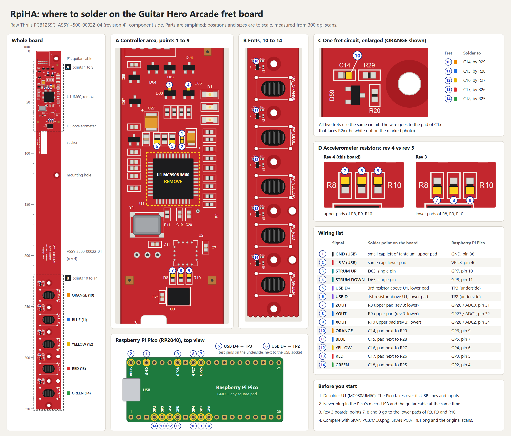

# RpiHA

**English** | [Polski](README.pl.md)

**Raspberry Pi HERO ARCADE**: a Raspberry Pi Pico replacement for the controller in the guitar of
the Raw Thrills *Guitar Hero Arcade* cabinet (2009).

The guitar neck holds one long PCB with the five fret switches, the strum sensor inputs, a tilt
accelerometer and a Freescale MC9S08JM60 microcontroller that talks to the cabinet over USB. RpiHA
removes that microcontroller and puts a Raspberry Pi Pico in its place. To the cabinet the Pico looks
exactly like the original guitar: same USB IDs, same descriptors byte for byte, same 7-byte input
report sent every 32 ms, same player assignment ("guitar mating"). The game cannot tell the
difference, so nothing on the cabinet side has to change.

The point is to keep these guitars playable when the original controller fails.



The drawing above is also available as a vector file: [docs/pcb_render.svg](docs/pcb_render.svg).

---

## Contents

- [What works](#what-works)
- [What you need](#what-you-need)
- [Step 1: identify your board revision](#step-1-identify-your-board-revision)
- [Step 2: flash the Pico](#step-2-flash-the-pico)
- [Step 3: remove U1](#step-3-remove-u1)
- [Step 4: wire the Pico to the board](#step-4-wire-the-pico-to-the-board)
- [Step 5: test on a PC](#step-5-test-on-a-pc)
- [Step 6: calibrate the tilt sensor](#step-6-calibrate-the-tilt-sensor)
- [Step 7: install in the cabinet and pair](#step-7-install-in-the-cabinet-and-pair)
- [Service modes and the Pico LED](#service-modes-and-the-pico-led)
- [How it works](#how-it-works)
- [Building the firmware](#building-the-firmware)
- [Tools in this repository](#tools-in-this-repository)
- [Repository layout](#repository-layout)
- [Troubleshooting](#troubleshooting)
- [License](#license)

---

## What works

| Function | Status |
|---|---|
| Five frets (GREEN, RED, YELLOW, BLUE, ORANGE) | working |
| Strum up / down, with automatic polarity detection | working |
| Tilt (3-axis analog accelerometer on the board) | working, needs a one-time calibration |
| USB enumeration identical to the original guitar | working (descriptors copied byte for byte from a recording) |
| Player assignment (P1 / P2 "guitar mating"), kept after power-off | working |
| Data the cabinet sends on the "RT-GH LED" interface | accepted and logged; only the mating command is understood |
| The three LEDs on the guitar board (D1 and its neighbours) | not driven by RpiHA |

---

## What you need

**A Raspberry Pi Pico with the RP2040 chip.** The original Pico or the Pico H. This is the reference
hardware and the board the wiring map is drawn for.

- A build for the **Pico 2** (RP2350) is included as well (`rtgh_pico2_rp2350.uf2`); the pinout is
  the same. The RP2040 Pico is the reference.
- **Pico W / Pico 2 W** run the firmware too, but their on-board LED hangs off the wireless chip, so
  the status LED stays dark.
- **Third-party RP2040 boards:** the USB data lines are taken from the test pads TP2 and TP3 on the
  underside of the Raspberry Pi Pico. Boards without these pads (RP2040-Zero, boards with USB-C, etc.)
  need another way to reach D+ and D−, so they are not covered here. The firmware also needs at least
  2 MB of flash (it uses the last 516 KB for settings and the log).

**Tools and materials**

- Hot air station or low-melt removal alloy, to take off U1 (LQFP-44).
- Fine-tip soldering iron, flux, desoldering wick.
- Thin insulated wire, about 30 AWG (wire-wrap / Kynar wire works well).
- Multimeter.
- A Windows PC for testing and calibration (the helper scripts use Windows-specific capture tools;
  flashing works from any OS).

---

## Step 1: identify your board revision

Look for the white text block in the middle of the board, next to `RAW THRILLS, INC.`:

```
GUITAR HERO FRET
ASSY #500-00022-04
```

`-04` is **revision 4**, the board in the drawing and in the photos. On revision 4 the
accelerometer is **U3** and the footprint **U2** above it is empty.

**Revision 3** uses a different accelerometer chip. It works the same way (three analog outputs
going through R8, R9 and R10), but the routing differs: points 7, 8 and 9 go to the **opposite
(lower) pads** of R8, R9 and R10. Everything else is identical. Panel D of the drawing shows both.

If your assembly number is something else, compare your board with the scans before you solder.

### Reference images

There are three ways to look at the same board. Use them side by side.

| File | What it is |
|---|---|
| [docs/pcb_render.png](docs/pcb_render.png) / [.svg](docs/pcb_render.svg) | Simplified drawing, to scale, with every solder point and the Pico pinout |
| [SKAN PCB/MCU.png](SKAN%20PCB/MCU.png) | Hand-marked photo of the controller end (points 1 to 9) |
| [SKAN PCB/FRET.png](SKAN%20PCB/FRET.png) | Hand-marked photo of the fret end (points 10 to 14) |
| [SKAN PCB/20261118224230.pdf](SKAN%20PCB/20261118224230.pdf) | Original scans, both sides, unedited. Page 1: front, controller end. Page 2: front, fret end. Pages 3 and 4: back side |

The board is more than 35 cm long and did not fit on the scanner in one piece, so every image is split
into a controller half and a fret half. The numbered white dots on the photos and the numbered discs
on the drawing mean the same thing.

---

## Step 2: flash the Pico

Do this first, before anything is soldered to the Pico.

1. Take the firmware file from [`firmware/bin/`](firmware/bin):

   | Board | File |
   |---|---|
   | Raspberry Pi Pico / Pico H (RP2040) | `rtgh_pico_rp2040.uf2` |
   | Raspberry Pi Pico 2 (RP2350) | `rtgh_pico2_rp2350.uf2` |

2. Hold the **BOOTSEL** button on the Pico and plug it into a computer with a micro-USB cable.
   Release the button.
3. A drive called `RPI-RP2` (or `RP2350`) appears. Copy the `.uf2` file onto it.
4. The Pico reboots on its own and from now on it is a guitar.

Once the Pico is inside a closed guitar, you can update it without opening anything: hold
**GREEN + ORANGE** while plugging the guitar cable into a PC. The `RPI-RP2` drive appears through the
guitar cable. See [Service modes](#service-modes-and-the-pico-led).

The first start after flashing takes about 2 seconds longer than usual, because the firmware erases
its log area in flash.

---

## Step 3: remove U1

U1 is the large 44-pin chip (MC9S08JM60) near the connector end. It has to come off completely: it
sits on the same USB lines and the same inputs the Pico will use.

- Use hot air with plenty of flux, or a low-melt removal alloy.
- Clean the pads with wick afterwards. Nothing is soldered to the U1 pads later, but there must be
  no solder bridges between them, especially around the USB pins.
- Leave everything else on the board in place. The board keeps its own 3.3 V regulator, the
  protection diodes, the filter parts and the accelerometer; RpiHA uses all of them.

---

## Step 4: wire the Pico to the board

All 14 points are on the component side. The numbers match the drawing and the marked photos.

| No. | Signal | Solder point on the guitar board | Pico |
|---|---|---|---|
| 1 | GND (from USB) | small capacitor left of the tantalum capacitor above U1, **upper** pad | GND, pin 38 (any GND) |
| 2 | +5 V (from USB) | the same capacitor, **lower** pad | VBUS, pin 40 |
| 3 | STRUM UP | D63, the single pin | GP7, pin 10 |
| 4 | STRUM DOWN | D65, the single pin | GP8, pin 11 |
| 5 | USB D+ | third resistor of the row of three above U1, lower pad | TP3 (underside) |
| 6 | USB D− | first resistor of that row, lower pad | TP2 (underside) |
| 7 | ZOUT (tilt) | R8, upper pad (rev 3: lower pad) | GP26 / ADC0, pin 31 |
| 8 | YOUT (tilt) | R9, upper pad (rev 3: lower pad) | GP27 / ADC1, pin 32 |
| 9 | XOUT (tilt) | R10, upper pad (rev 3: lower pad) | GP28 / ADC2, pin 34 |
| 10 | ORANGE fret | C14, the pad facing R29 | GP6, pin 9 |
| 11 | BLUE fret | C15, the pad facing R28 | GP5, pin 7 |
| 12 | YELLOW fret | C16, the pad facing R27 | GP4, pin 6 |
| 13 | RED fret | C17, the pad facing R26 | GP3, pin 5 |
| 14 | GREEN fret | C18, the pad facing R25 | GP2, pin 4 |

"Upper" and "lower" refer to the board held like in the photos, with the P1 connector at the top.
Pico pin numbers are physical pin numbers: pin 1 is GP0 next to the USB socket, pins 1 to 20 run
down one edge and 21 to 40 back up the other (see the drawing).

### Notes per group

**Power (1, 2).** The guitar cable supplies 5 V. It goes into the Pico's VBUS pin, so the Pico is
powered exactly as if it were plugged into USB. The guitar board keeps its own 3.3 V regulator for
the accelerometer, the strum sensor and the pull-ups.

- **Do not connect the Pico's 3V3 pin to the board.** Two regulators must not be tied together.
- **Never plug in the Pico's micro-USB and the guitar cable at the same time.** Both feed the same
  5 V and the same data lines.

**USB data (5, 6).** TP2 (D−) and TP3 (D+) are test pads on the underside of the Pico, next to the
micro-USB socket; they connect straight to the USB lines. Keep these two wires short, run them next
to each other (twisted if you can), and don't swap them: with D+ and D− reversed the cable simply
does not enumerate.

**Strum (3, 4).** The single pin of each SOT-23 protection diode is the signal line from the strum
sensor. Before connecting it to the Pico, power the board from the guitar cable and measure both
lines in both strum positions: **they must never go above 3.3 V**. If up and down come out
reversed, swap the wires (or swap `PIN_STRUM_UP` and `PIN_STRUM_DOWN` in `firmware/src/pins.h`).
Do not touch the strum bar while plugging the guitar in: its idle level is measured at power-up.

**Frets (10 to 14).** Every fret has the same small circuit next to its switch: a capacitor C1x, a
resistor R2x, a SOT-23 diode D5x and a second resistor. The wire goes to the pad of C1x that faces
R2x (panel C of the drawing). The membrane switch pulls that line to ground when pressed; the Pico
provides the pull-up internally.

**Tilt (7, 8, 9).** The accelerometer outputs reach the Pico's ADC through the 1 kΩ resistors R8, R9
and R10. You solder to the side that used to go to U1. On rev 4 that is the upper pad, on rev 3 the
lower one. Optional: if the tilt readings are noisy, add a second ground wire from the board ground
near U3 to the Pico's AGND (pin 33).

**Mounting.** Fix the Pico so it cannot move, and insulate its underside: the TP2 and TP3 wires
leave from there.

---

## Step 5: test on a PC

1. Plug the guitar cable (not the Pico's micro-USB) into a Windows PC.
2. Open `joy.cpl` (Game Controllers), select `RT GH CONTROLLER`, Properties.
3. Frets light up buttons 1 to 5 (GREEN = 1, RED = 2, BLUE = 3, YELLOW = 4, ORANGE = 5). Strum
   moves the POV hat up and down. Tilting the guitar moves the axes (after calibration).

For a full comparison with the original guitar, run `capture.py --verify` (see
[Tools](#tools-in-this-repository)). It records the Pico's enumeration and idle report and compares
them with `profile.json` byte by byte.

---

## Step 6: calibrate the tilt sensor

The original controller converts the accelerometer voltages into report bytes with its own formula,
which is not known. RpiHA reproduces it by measurement: you hold the original guitar and the Pico
guitar in the same eight positions and a script fits a linear conversion for each axis.

The calibration shipped in `profile.json` was made on a rev 4 board. If tilt feels wrong on your
guitar, and on rev 3 boards in general, repeat it:

1. Original guitar to the PC: `py -3.13 calib_accel.py original` (8 positions, 2 s each).
2. Pico guitar in calibration mode: hold **GREEN + RED** while plugging it in (the Pico LED blinks
   twice per second), then `py -3.13 calib_accel.py pico` with the same positions.
3. `py -3.13 calib_accel.py fit` fits the conversion and stores it in `profile.json`.
4. Rebuild the firmware (see [Building](#building-the-firmware)) and flash it.

`calib_accel.py live` and `calib_accel.py view` show the readings in real time, which is handy to
check the wiring of points 7 to 9. The board must be mounted in the guitar the same way as in the
original, otherwise the positions don't match.

---

## Step 7: install in the cabinet and pair

Plug the guitar into the cabinet as usual. The Pico enumerates exactly like the original guitar.

Each guitar remembers whether it is player 1 or player 2. A new Pico starts as P1. To change it, run
guitar mating from the cabinet's operator menu the same way as with an original guitar (ORANGE,
hold GREEN, then press the P1 or P2 START button). The Pico stores the result in flash and keeps it
after power-off.

---

## Service modes and the Pico LED

Frets held while the guitar cable is plugged in select a mode. Do not touch the strum bar at that
moment.

| Held at power-up | Mode |
|---|---|
| GREEN + RED | tilt calibration: raw ADC values in the report instead of tilt bytes |
| BLUE + ORANGE | log dump: the guitar becomes a serial port (COM) for `read_pico_log.py` |
| GREEN + ORANGE | UF2 bootloader: the `RPI-RP2` drive appears, copy a new `.uf2` onto it |

With the guitar open you can also use the Pico itself:

- **BOOTSEL** pressed briefly (0.1 to 0.7 s) while running: calibration mode on / off.
- **BOOTSEL** held for 1 s while running: restart into log dump mode.
- Jumper between **GP9 and GND** (pins 12 and 13) at power-up: log dump mode.

The Pico's LED, if you can see it:

| LED | Meaning |
|---|---|
| slow blink (once per second) | no USB host has configured the guitar yet |
| on | configured and idle |
| off | a fret or strum is held |
| short flicker | the cabinet sent a packet to the LED interface |
| two blinks per second | tilt calibration mode |
| double flash every second | log dump mode |
| fast blink | the flash log is full |

---

## How it works

### The big picture

```
 cabinet PC              guitar neck PCB (U1 removed)              Raspberry Pi Pico
┌───────────┐  cable   ┌──────────────────────────────────────┐
│           │ +5 V, GND│ points 1, 2 ─────────────────────────┼──► VBUS, GND
│   game    │ D+, D−   │ P1 ── resistors ── points 5, 6 ──────┼──► TP3, TP2
│           │◄────────►│ fret switches ── points 10-14 ───────┼──► GP2 .. GP6
└───────────┘          │ strum sensor ── points 3, 4 ─────────┼──► GP7, GP8
                       │ accelerometer ─ 1k ─ points 7-9 ─────┼──► GP26 .. GP28
                       └──────────────────────────────────────┘
```

The Pico runs a single loop:

- every 1 ms it reads the seven digital inputs and the three ADC channels;
- whenever the HID endpoint is free, it builds a fresh 7-byte report and hands it to the USB stack,
  which delivers it at the cabinet's next poll;
- it serves everything else the cabinet asks for over USB (descriptors, control requests, packets on
  the LED interface);
- it writes a diagnostic log to its own flash;
- it feeds a 1 s watchdog, so a hang turns into a reboot instead of a dead guitar.

USB is handled by TinyUSB (part of the Pico SDK) running on the RP2040's native full-speed USB
controller.

### Guitar to cabinet: enumeration

Everything the cabinet reads during enumeration was recorded from an original guitar (`capture.py`,
saved in `profile.json`) and is compiled into the firmware unchanged (`firmware/src/rtgh_profile.h`,
generated by `gen_firmware_header.py`). Nothing is rebuilt from a template, so the cabinet receives
the original bytes, including the oddities.

**Device descriptor**

| Field | Value |
|---|---|
| USB version (bcdUSB) | 1.01 |
| Control endpoint packet size | 8 bytes |
| Vendor ID / Product ID | `0x0C70` / `0x0777` |
| Device release | 0.00 |
| Manufacturer string | `RAW THRILLS,INC.` |
| Product string | `RT GH CONTROLLER` |
| Serial number | none |

**Configuration descriptor** (67 bytes, one configuration, bus powered, 0 mA declared, configuration
string `Default configuration`). It contains an OTG descriptor right after the header, then two
interfaces:

| Interface | Class | Name | Endpoints |
|---|---|---|---|
| 0 | HID (protocol 3) | `RT-GH INPUT ` | 0x81 interrupt IN, 8 bytes, polled every 32 ms |
| 1 | vendor specific (0xFF / 0x01 / 0xFF) | `RT-GH LED   ` | 0x82 interrupt IN, 0x03 interrupt OUT, 0x84 interrupt IN, 64 bytes each, 1 ms |

The trailing spaces in the interface names are part of the original strings. There is also a string
at index 3, `V0.1`, that no descriptor points to; the Pico returns it too if asked. Strings are
returned the same way regardless of the language ID requested, as the original does.

One detail needs a workaround. TinyUSB parses the configuration descriptor itself when the host
selects the configuration, and its parser stops on the OTG descriptor. The firmware therefore keeps
two copies: the original 67 bytes are sent whenever the cabinet asks for the descriptor, and a copy
without the 3-byte OTG descriptor is given to TinyUSB's parser when the host sends
SET_CONFIGURATION. The callback tells the two cases apart by looking at the current SETUP packet in
the USB controller's memory.

### Guitar to cabinet: the input report

The HID report descriptor (83 bytes) describes a joystick with five 8-bit signed axes, a 4-bit hat
switch and twelve 1-bit buttons, 7 bytes in total, without a report ID. It also contains a Throttle
usage with a report count of zero, which adds no data; it is kept as it is.

| Byte | Bits | HID usage | Filled by RpiHA from | Idle value recorded on the original |
|---|---|---|---|---|
| 0 | 0-7 | X | constant | `0x20` |
| 1 | 0-7 | Y | tilt, XOUT (GP28) | `0xF7` |
| 2 | 0-7 | Z | tilt, ZOUT (GP26) | `0x81` |
| 3 | 0-7 | Rx | constant | `0xFF` |
| 4 | 0-7 | Ry | tilt, YOUT (GP27) | `0xF7` |
| 5 | 0-3 | Hat switch | strum: 0 = up, 2 = down, 15 = centred | 15 |
| 5 | 4 | Button 1 | GREEN | 0 |
| 5 | 5 | Button 2 | RED | 0 |
| 5 | 6 | Button 3 | BLUE | 0 |
| 5 | 7 | Button 4 | YELLOW | 0 |
| 6 | 0 | Button 5 | ORANGE | 0 |
| 6 | 1 | Button 6 | not used | 0 |
| 6 | 2 | Button 7 | always 1, like the original | 1 |
| 6 | 3 | Button 8 | not used | 0 |
| 6 | 4-7 | Buttons 9, 10 and two bits without a usage | player number, one bit set: bit 4 = P1, bit 5 = P2 | bit 4 (P1) |

The complete idle report of the original guitar is `20 F7 81 FF F7 0F 14`. The Pico starts from
these bytes and overwrites only the fields it drives. If strum up and down are both active, the hat
stays at 15.

**Timing.** The cabinet polls endpoint 0x81 every 32 ms. The original guitar answers every poll
with a full report, whether something changed or not, and so does the Pico: as soon as one report
has been collected, the next one is built and queued. That report waits in the endpoint buffer
until the next poll, so the state the cabinet receives is up to one polling interval old, and a
press made just after a report was queued reaches the cabinet within about two intervals.

The cabinet may also read the report with a GET_REPORT control request; the Pico answers with the
current input report. Requests for other report types are stalled.

### Inputs on the board

**Frets.** GP2 to GP6 are inputs with the RP2040's internal pull-up (50 to 80 kΩ). A pressed
membrane connects the line to ground through its own resistance (a few hundred ohms to a few kΩ),
which reads as a clean low. Each input is sampled every millisecond and a new state is accepted only
after it has been stable for 5 ms (`DEBOUNCE_MS` in `pins.h`).

**Strum.** GP7 and GP8 also have pull-ups, but the strum sensor may idle high or low. At power-up
the firmware samples each strum line 50 times over 50 ms and takes the majority as the idle level;
anything else counts as "pressed". This works for an optical sensor of either polarity and for a
plain switch to ground. It is controlled by `STRUM_AUTO_POLARITY` in `pins.h`, and the detected
levels are written to the log (`strum idle: up=H down=H`).

**Tilt.** The accelerometer outputs sit at about half the supply at 0 g and swing with tilt. The
Pico reads them on ADC0 to ADC2 (12 bits, 0 to 3.3 V). Every millisecond each channel is read four
times, averaged, and passed through a first-order low-pass filter (each new sample contributes 1/8,
a time constant of roughly 8 ms). Each tilt byte of the report is then:

```
byte = c0 + c1 * ADC0 + c2 * ADC1 + c3 * ADC2      (rounded, limited to -127 .. 127)
```

The coefficients come from the calibration in `profile.json`. With the current calibration only one
channel feeds each byte:

| Report byte | Formula | Fit error (RMS) |
|---|---|---|
| 1 (Y) | 219.2 − 0.1146 × XOUT | 4.6 |
| 2 (Z) | 284.7 − 0.1443 × ZOUT | 9.4 |
| 4 (Ry) | 291.2 − 0.1473 × YOUT | 1.9 |

In calibration mode the tilt bytes are replaced by raw data: the three readings, shifted down to 10
bits, are packed into bytes 0 to 3 (ADC0 in bits 0-9, ADC1 in bits 10-19, ADC2 in bits 20-29) and
byte 4 holds the marker `0xA5`. `calib_accel.py` reads them from there.

### Cabinet to guitar: the "RT-GH LED" interface

Interface 1 carries data from the game to the guitar. The cabinet sends 64-byte packets on interrupt
OUT endpoint 0x03.

- The Pico always accepts these packets, so the cabinet never stalls on them.
- Each packet that differs from the previous one is written to the log and makes the LED flicker.
- The only command understood so far is the mating command, described below. Other packets are
  accepted and logged; their meaning is not known yet.

The two IN endpoints, 0x82 and 0x84, never carry data. The firmware answers polls on them with NAK
(the USB "nothing to send") and counts those polls in its statistics. A recording made with the proxy
firmware between a cabinet and an original guitar showed that the original does not use them either.

Vendor or class control requests to this interface or to the device are handled like this: requests
that send data to the guitar are accepted and their data logged; requests that expect data back are
stalled, because the original's answer is unknown. During the recordings the cabinet did not send
any.

### Player assignment ("guitar mating")

Recorded between a cabinet and an original guitar with the proxy firmware:

1. The game sends a packet starting with `03 0n` on endpoint 0x03, where `n = 0` means player 1 and
   `n = 1` player 2.
2. The original guitar confirms in its input report: byte 6, bits 4 to 7, has exactly one bit set,
   bit `4 + n`. Byte 6 therefore reads `0x14` for P1 and `0x24` for P2 (bit 2, Button 7, is always
   set). The confirmation arrives about 50 ms after the command.
3. Without a confirmation the game repeats `03 0n` every 250 ms. After the cabinet boots it keeps
   trying for about 9 seconds and then gives up.

The Pico sets the new player bit in the very next report. One second later, once things are quiet,
it writes the number to flash (a 4 KB sector just below the log area, tagged `RTGHCFG1`), so the
guitar answers as the same player after a power cycle, like the original.

### Diagnostic log in flash

Inside a cabinet there is nobody to watch a serial console, so the firmware records what happens to
it in the last 512 KB of the Pico's flash. The log survives power-off; each power-up starts a new
session in it.

Recorded events:

- every control request (the 8-byte SETUP packet),
- bus reset, suspend, resume, unplug, configured / unconfigured,
- data received on the LED interface (only when it changes),
- HID GET_REPORT and SET_REPORT,
- input changes (bit mask of the seven inputs),
- text lines: firmware version, player number, strum idle levels, ADC readings at boot, watchdog
  resets,
- every 2 s, if anything changed: number of reports sent, number of LED packets, how often the host
  polled each IN endpoint and got a NAK, number of log records lost.

Format: a 4 KB header sector (`RTGHLOG1` and the area size), followed by 256-byte pages of records
`[type, 1 byte][length, 1 byte][time in ms since boot, 4 bytes LE][data, up to 80 bytes]`. A type of
`0xFF` ends the data in a page. Records are collected in a 16 KB RAM buffer (safe to use from
interrupts) and written a page at a time, when a page is full, after 300 ms without new events, or
when data has waited 2 s. The area is erased at power-up when its header is missing or less than
64 KB is free. When it fills up during a session, further events are dropped and the LED blinks fast.

To read it, start the guitar in log dump mode (BLUE + ORANGE at power-up, BOOTSEL held 1 s, or the
GP9 jumper). The Pico then enumerates as a USB serial port with VID:PID `2E8A:000A`, a different
identity from the guitar, so Windows does not mix them up. It answers single-byte commands:

| Command | Answer |
|---|---|
| `I` | one text line: address and size of the log area, whether the header is valid |
| `D` | `RTGHDUMP`, address (u32 LE), size (u32 LE), then the raw 512 KB |
| `C` | erases the header (the full erase follows at the next normal start), answers `CLEARED` |

`read_pico_log.py` finds the port, downloads and decodes the log, and saves it as
`pico_log_<date>.txt`. With `--clear` it also erases the log afterwards.

### Debug UART

A text log of the same events goes to UART0: GP0 (pin 1) is TX, 115200 baud, 8N1. Connect a
3.3 V USB-to-serial adapter (Pico TX to adapter RX, plus ground) if you want to watch it live.

---

## Building the firmware

The prebuilt files in `firmware/bin/` are enough to use RpiHA. Rebuild only after changing
`pins.h`, the calibration or the code.

Requirements: Raspberry Pi Pico SDK 2.x (developed with 2.3.1), the Arm GNU toolchain
(`arm-none-eabi-gcc`), CMake, Ninja, picotool (the SDK fetches and builds it when it can't find
one), and Python 3 for the header generator.

```bash
python3 gen_firmware_header.py
```

```bash
cmake -S firmware -B build/pico -G Ninja -DPICO_SDK_PATH=/path/to/pico-sdk -DPICO_BOARD=pico
```

```bash
cmake --build build/pico
```

The result is `build/pico/rtgh_pico.uf2`. Use `-DPICO_BOARD=pico2` for the Pico 2.

`gen_firmware_header.py` turns `profile.json` (descriptors, input map, idle report, calibration) into
`firmware/src/rtgh_profile.h`. Run it after every change to `profile.json`.

On Windows, `firmware/build.ps1` does all of this in one go with portable tools in `C:\pico` (SDK,
toolchain, CMake, Ninja, picotool) and builds every variant into `firmware/bin/`:

```bash
powershell -ExecutionPolicy Bypass -File firmware\build.ps1
```

Keep the build directory on a path without spaces or non-ASCII characters; the Arm toolchain on
Windows does not cope with them. `build.ps1` copies the sources to `C:\pico\rtgh_pico` for that
reason.

The proxy firmware (`rtgh_proxy`, RP2040 only) is built only when the Pico-PIO-USB library is
present in the SDK at `lib/tinyusb/hw/mcu/raspberry_pi/Pico-PIO-USB`. It also needs a small patch to
TinyUSB's `usbh.c` so the host side skips the OTG descriptor of the original guitar;
`build.ps1` applies it.

---

## Tools in this repository

These were used to reverse-engineer the original guitar and to check the Pico against it. You don't
need them to build or install RpiHA. They expect Python 3.13 on Windows
(`py -3.13 -m pip install hidapi pyserial`; install `hidapi`, not the package called `hid`).

| Tool | What it does |
|---|---|
| `capture.py` | Profiles an original guitar: device, configuration, HID and string descriptors (recorded with Wireshark's USBPcap, so it needs an administrator terminal), the input map (press each fret and strum when asked), the idle report, noisy bits, and the report timing. Writes `profile.json`. With `--verify` it records the Pico the same way and compares it with the profile byte by byte. |
| `gen_firmware_header.py` | `profile.json` to `firmware/src/rtgh_profile.h`. |
| `calib_accel.py` | Tilt calibration: `original`, `pico`, `fit`, plus `live` and `view` to watch the readings. |
| `read_pico_log.py` | Downloads and decodes the flash log from a Pico in log dump mode. Can also read a flash image (`--file`) or use `picotool`. |
| `firmware/bin/rtgh_proxy_rp2040.uf2` | Recorder that sits between the cabinet and an **original** guitar and passes everything through in both directions while logging it. The guitar connects to a USB-A socket wired to GP16 (D+), GP17 (D−), VBUS and GND. This is how the mating protocol was found. |
| `docs/make_pcb_render.py` | Regenerates both drawings (`pcb_render.svg` in English, `pcb_render.pl.svg` in Polish) from the measured part positions. The captions of both versions are in the `TEXTS` dictionary in the script. |

---

## Repository layout

```
firmware/
  bin/                     prebuilt .uf2 files
  src/
    main.c                 inputs, ADC, report building, mating, service modes, LED
    usb_descriptors.c      descriptor callbacks (original bytes, OTG workaround)
    led_iface.c            vendor interface "RT-GH LED" (EP 0x82, 0x03, 0x84)
    rtgh_profile.h         generated from profile.json, do not edit
    pins.h                 pin assignment, debounce, strum polarity
    usblog.c               event log in flash
    dump_mode.c            log dump over USB serial, BOOTSEL handling
    settings.c             player number in flash
    proxy_main.c           proxy / recorder firmware
    tusb_config.h          TinyUSB configuration
  CMakeLists.txt
  build.ps1                Windows build script
docs/
  pcb_render.svg / .png    wiring map, English
  pcb_render.pl.svg / .png wiring map, Polish
  make_pcb_render.py       generator for both versions of the wiring map
  dev-notes-pl.md          original development notes (Polish)
SKAN PCB/                  scans of the board: marked photos and the original PDF
profile.json               everything recorded from the original guitar
accel_original.json        tilt calibration measurements, original guitar
accel_pico.json            tilt calibration measurements, Pico guitar
capture.py, calib_accel.py, gen_firmware_header.py, read_pico_log.py
```

The raw USB captures (`*.pcap`) and flash logs (`pico_log_*.txt`) that the tools produce are not part
of the repository: everything needed from them is in `profile.json`, and a raw capture also records
other devices on the same USB controller.

---

## Troubleshooting

**The PC or cabinet does not see the guitar.** Check D+ and D− (points 5 and 6) for a swap or a bad
joint, and check that U1 is completely gone with no bridges left on its pads. Then read the log: if
there is no `MOUNT` entry, the host rejected the device during enumeration.

**A fret reads as permanently pressed.** Look for a short to ground on that wire. Also check that the
board's own 3.3 V rail is present when the guitar cable is plugged in.

**Strum works backwards.** Swap the wires of points 3 and 4, or swap `PIN_STRUM_UP` and
`PIN_STRUM_DOWN` in `pins.h` and rebuild.

**Strum is stuck in one direction.** The strum bar was moved while the guitar was being plugged in,
so the wrong idle level was learned. Unplug, leave the strum alone, plug in again.

**Tilt does nothing.** Without a calibration the tilt bytes stay at their idle values. Calibrate
(step 6). Use `calib_accel.py live` to check that all three ADC channels react.

**Windows shows old names or a wrong button map after a firmware change.** Windows caches devices by
VID/PID. In Device Manager enable *View, Show hidden devices* and uninstall every entry of the guitar,
including the greyed-out ones (USB composite device, USB input device, HID-compliant game
controller, `RT-GH LED`), then plug it in again. Windows asks for the Microsoft OS string descriptor
(index 0xEE) only the first time it sees a VID/PID/version combination; to make it ask again, delete
`HKLM\SYSTEM\CurrentControlSet\Control\usbflags\0C7007770000` as administrator.

---

## License

MIT, see [LICENSE](LICENSE).

Not affiliated with Raw Thrills or Activision. Guitar Hero is a trademark of its respective owner.
