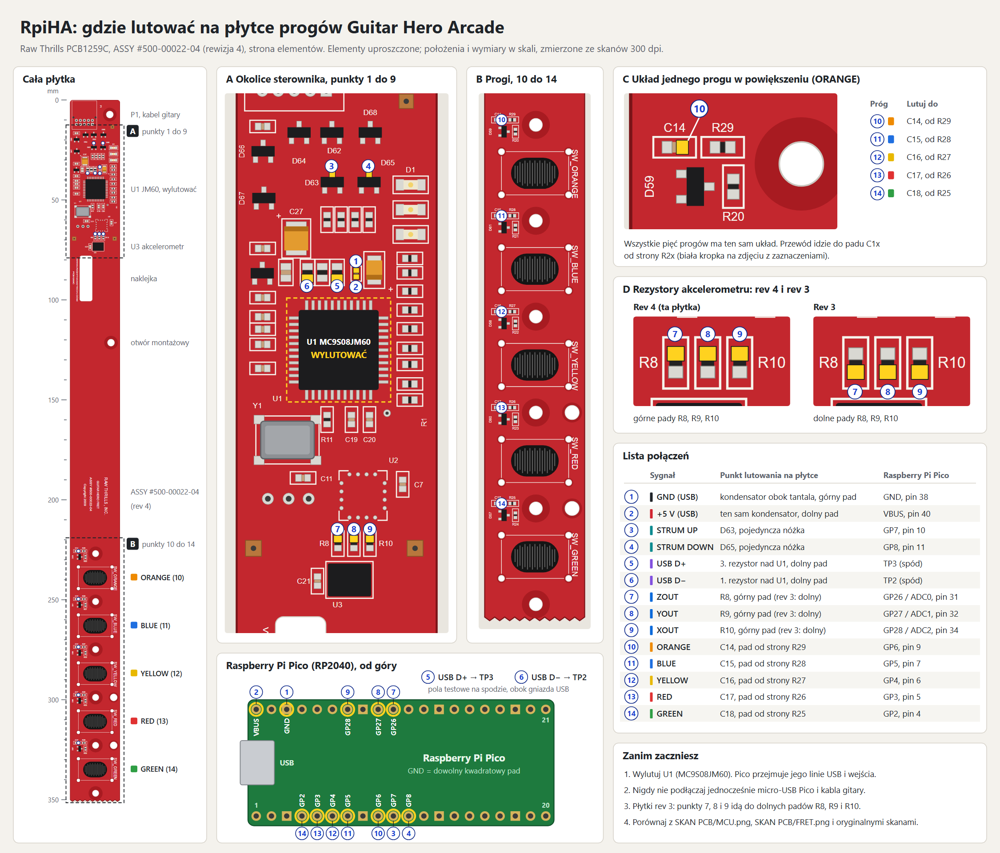

# RpiHA

[English](README.md) | **Polski**

**Raspberry Pi HERO ARCADE**: zamiennik sterownika w gitarze automatu *Guitar Hero Arcade* firmy
Raw Thrills (2009), zbudowany na Raspberry Pi Pico.

W gryfie gitary jest jedna długa płytka z pięcioma progami, wejściami czujnika strum,
akcelerometrem do przechyłu i mikrokontrolerem Freescale MC9S08JM60, który rozmawia z automatem
przez USB. RpiHA usuwa ten mikrokontroler i wstawia na jego miejsce Raspberry Pi Pico. Dla automatu
Pico wygląda dokładnie jak oryginalna gitara: te same identyfikatory USB, te same deskryptory bajt
w bajt, ten sam 7-bajtowy raport wysyłany co 32 ms, to samo przypisanie gracza („guitar mating”).
Gra nie widzi różnicy, więc po stronie automatu nic nie trzeba zmieniać.

Chodzi o to, żeby te gitary dalej działały, kiedy oryginalny sterownik odmówi posłuszeństwa.



Rysunek jest też dostępny w wersji wektorowej: [docs/pcb_render.pl.svg](docs/pcb_render.pl.svg).

---

## Spis treści

- [Co działa](#co-działa)
- [Co jest potrzebne](#co-jest-potrzebne)
- [Krok 1: rozpoznaj rewizję płytki](#krok-1-rozpoznaj-rewizję-płytki)
- [Krok 2: wgraj firmware do Pico](#krok-2-wgraj-firmware-do-pico)
- [Krok 3: wylutuj U1](#krok-3-wylutuj-u1)
- [Krok 4: podłącz Pico do płytki](#krok-4-podłącz-pico-do-płytki)
- [Krok 5: test na PC](#krok-5-test-na-pc)
- [Krok 6: kalibracja przechyłu](#krok-6-kalibracja-przechyłu)
- [Krok 7: montaż w automacie i parowanie](#krok-7-montaż-w-automacie-i-parowanie)
- [Tryby serwisowe i dioda Pico](#tryby-serwisowe-i-dioda-pico)
- [Jak to działa](#jak-to-działa)
- [Kompilacja firmware](#kompilacja-firmware)
- [Narzędzia w repozytorium](#narzędzia-w-repozytorium)
- [Struktura repozytorium](#struktura-repozytorium)
- [Rozwiązywanie problemów](#rozwiązywanie-problemów)
- [Licencja](#licencja)

---

## Co działa

| Funkcja | Stan |
|---|---|
| Pięć progów (GREEN, RED, YELLOW, BLUE, ORANGE) | działa |
| Strum góra / dół, z automatycznym wykrywaniem polaryzacji | działa |
| Przechył (3-osiowy analogowy akcelerometr na płytce) | działa, wymaga jednorazowej kalibracji |
| Enumeracja USB identyczna z oryginalną gitarą | działa (deskryptory skopiowane bajt w bajt z nagrania) |
| Przypisanie gracza (P1 / P2, „guitar mating”), pamiętane po wyłączeniu | działa |
| Dane, które automat wysyła na interfejs „RT-GH LED” | przyjmowane i logowane; rozumiana jest tylko komenda parowania |
| Trzy diody LED na płytce gitary (D1 i sąsiednie) | RpiHA ich nie steruje |

---

## Co jest potrzebne

**Raspberry Pi Pico z układem RP2040.** Oryginalne Pico albo Pico H. To jest sprzęt referencyjny i
dla niego jest narysowana mapa połączeń.

- Jest też gotowy plik dla **Pico 2** (RP2350): `rtgh_pico2_rp2350.uf2`. Rozkład pinów jest ten sam.
  Punktem odniesienia pozostaje Pico z RP2040.
- **Pico W / Pico 2 W** też uruchomią firmware, ale ich dioda na płytce wisi na układzie Wi-Fi, więc
  dioda stanu nie będzie świecić.
- **Płytki z RP2040 innych producentów:** linie danych USB są brane z pól testowych TP2 i TP3 na
  spodzie Raspberry Pi Pico. Płytki bez tych pól (RP2040-Zero, płytki z USB-C itp.) wymagają innego
  sposobu dojścia do D+ i D−, więc ten opis ich nie obejmuje. Firmware potrzebuje też co najmniej
  2 MB flasha (ostatnie 516 KB zajmują ustawienia i log).

**Narzędzia i materiały**

- Hot air albo stop niskotopliwy do wylutowywania, żeby zdjąć U1 (LQFP-44).
- Lutownica z cienkim grotem, topnik, plecionka.
- Cienki izolowany przewód, około 30 AWG (dobrze sprawdza się przewód do wire-wrap / Kynar).
- Multimetr.
- Komputer z Windows do testów i kalibracji (skrypty pomocnicze korzystają z narzędzi do
  przechwytywania USB dostępnych tylko na Windows; samo wgrywanie firmware działa na każdym systemie).

---

## Krok 1: rozpoznaj rewizję płytki

Znajdź biały blok tekstu w środkowej części płytki, obok napisu `RAW THRILLS, INC.`:

```
GUITAR HERO FRET
ASSY #500-00022-04
```

`-04` oznacza **rewizję 4**, czyli płytkę z rysunku i zdjęć. W rewizji 4 akcelerometr to **U3**, a
pole **U2** nad nim jest puste.

**Rewizja 3** ma inny układ akcelerometru. Działa tak samo (trzy wyjścia analogowe przez R8, R9 i
R10), ale ścieżki biegną inaczej: punkty 7, 8 i 9 lutuje się do **przeciwnych (dolnych) padów** R8,
R9 i R10. Cała reszta jest identyczna. Panel D rysunku pokazuje obie wersje.

Jeśli numer ASSY na Twojej płytce jest inny, porównaj ją ze skanami, zanim zaczniesz lutować.

### Obrazy referencyjne

Tę samą płytkę można obejrzeć na trzy sposoby. Najlepiej mieć je otwarte obok siebie.

| Plik | Co to jest |
|---|---|
| [docs/pcb_render.pl.png](docs/pcb_render.pl.png) / [.svg](docs/pcb_render.pl.svg) | Uproszczony rysunek w skali, ze wszystkimi punktami lutowania i rozkładem pinów Pico |
| [SKAN PCB/MCU.png](SKAN%20PCB/MCU.png) | Zdjęcie z ręcznie zaznaczonymi punktami, strona sterownika (punkty 1 do 9) |
| [SKAN PCB/FRET.png](SKAN%20PCB/FRET.png) | Zdjęcie z ręcznie zaznaczonymi punktami, strona progów (punkty 10 do 14) |
| [SKAN PCB/20261118224230.pdf](SKAN%20PCB/20261118224230.pdf) | Oryginalne skany obu stron, bez edycji. Strona 1: przód, część ze sterownikiem. Strona 2: przód, część z progami. Strony 3 i 4: spód |

Płytka ma ponad 35 cm długości i nie zmieściła się na skanerze w całości, dlatego każdy obraz jest
podzielony na połowę ze sterownikiem i połowę z progami. Ponumerowane białe kropki na zdjęciach i
ponumerowane kółka na rysunku znaczą to samo.

---

## Krok 2: wgraj firmware do Pico

Zrób to najpierw, zanim cokolwiek przylutujesz do Pico.

1. Weź plik z [`firmware/bin/`](firmware/bin):

   | Płytka | Plik |
   |---|---|
   | Raspberry Pi Pico / Pico H (RP2040) | `rtgh_pico_rp2040.uf2` |
   | Raspberry Pi Pico 2 (RP2350) | `rtgh_pico2_rp2350.uf2` |

2. Przytrzymaj przycisk **BOOTSEL** na Pico i podłącz je do komputera kablem micro-USB. Puść
   przycisk.
3. Pojawi się dysk `RPI-RP2` (albo `RP2350`). Skopiuj na niego plik `.uf2`.
4. Pico samo się zrestartuje i od tej chwili jest gitarą.

Kiedy Pico siedzi już w zamkniętej gitarze, firmware można zaktualizować bez rozkręcania: trzymaj
**GREEN + ORANGE** podczas podłączania kabla gitary do komputera. Dysk `RPI-RP2` pojawi się przez
kabel gitary. Zobacz [Tryby serwisowe](#tryby-serwisowe-i-dioda-pico).

Pierwsze uruchomienie po wgraniu trwa około 2 sekundy dłużej niż zwykle, bo firmware kasuje obszar
logu we flashu.

---

## Krok 3: wylutuj U1

U1 to duży 44-pinowy układ (MC9S08JM60) w pobliżu złącza. Musi zniknąć z płytki całkowicie: siedzi
na tych samych liniach USB i tych samych wejściach, których będzie używać Pico.

- Użyj hot aira z dużą ilością topnika albo stopu niskotopliwego.
- Potem wyczyść pady plecionką. Do padów U1 nic się później nie lutuje, ale nie może między nimi
  zostać żaden mostek z cyny, zwłaszcza w okolicy pinów USB.
- Wszystko inne zostaw na płytce. Płytka zachowuje własny stabilizator 3,3 V, diody ochronne,
  elementy filtrów i akcelerometr; RpiHA korzysta z nich wszystkich.

---

## Krok 4: podłącz Pico do płytki

Wszystkie 14 punktów jest po stronie elementów. Numery są takie same jak na rysunku i na zdjęciach.

| Nr | Sygnał | Punkt lutowania na płytce gitary | Pico |
|---|---|---|---|
| 1 | GND (z USB) | mały kondensator na lewo od kondensatora tantalowego nad U1, pad **górny** | GND, pin 38 (dowolny GND) |
| 2 | +5 V (z USB) | ten sam kondensator, pad **dolny** | VBUS, pin 40 |
| 3 | STRUM UP | D63, pojedyncza nóżka | GP7, pin 10 |
| 4 | STRUM DOWN | D65, pojedyncza nóżka | GP8, pin 11 |
| 5 | USB D+ | trzeci rezystor z rzędu trzech nad U1, pad dolny | TP3 (spód) |
| 6 | USB D− | pierwszy rezystor z tego rzędu, pad dolny | TP2 (spód) |
| 7 | ZOUT (przechył) | R8, pad górny (rev 3: dolny) | GP26 / ADC0, pin 31 |
| 8 | YOUT (przechył) | R9, pad górny (rev 3: dolny) | GP27 / ADC1, pin 32 |
| 9 | XOUT (przechył) | R10, pad górny (rev 3: dolny) | GP28 / ADC2, pin 34 |
| 10 | próg ORANGE | C14, pad od strony R29 | GP6, pin 9 |
| 11 | próg BLUE | C15, pad od strony R28 | GP5, pin 7 |
| 12 | próg YELLOW | C16, pad od strony R27 | GP4, pin 6 |
| 13 | próg RED | C17, pad od strony R26 | GP3, pin 5 |
| 14 | próg GREEN | C18, pad od strony R25 | GP2, pin 4 |

„Górny” i „dolny” odnoszą się do płytki ułożonej jak na zdjęciach, ze złączem P1 u góry. Numery
pinów Pico to numery fizyczne: pin 1 to GP0 przy gnieździe USB, piny 1 do 20 biegną wzdłuż jednej
krawędzi, a 21 do 40 wracają drugą (zobacz rysunek).

### Uwagi do poszczególnych grup

**Zasilanie (1, 2).** Kabel gitary daje 5 V. Trafia ono na pin VBUS, więc Pico jest zasilane
dokładnie tak, jakby było podłączone do USB. Płytka gitary zachowuje własny stabilizator 3,3 V dla
akcelerometru, czujnika strum i rezystorów podciągających.

- **Nie łącz pinu 3V3 Pico z płytką.** Dwóch stabilizatorów nie wolno spinać ze sobą.
- **Nigdy nie podłączaj jednocześnie micro-USB Pico i kabla gitary.** Oba podają te same 5 V i
  korzystają z tych samych linii danych.

**Dane USB (5, 6).** TP2 (D−) i TP3 (D+) to pola testowe na spodzie Pico, obok gniazda micro-USB,
połączone bezpośrednio z liniami USB. Oba przewody zrób krótkie, prowadź je razem (najlepiej
skręcone) i nie zamieniaj ich: przy zamienionych D+ i D− urządzenie po prostu się nie zgłosi.

**Strum (3, 4).** Pojedyncza nóżka każdej diody ochronnej w obudowie SOT-23 to linia sygnałowa z
czujnika strum. Zanim podłączysz ją do Pico, zasil płytkę z kabla gitary i zmierz obie linie w obu
położeniach strum: **napięcie nie może przekroczyć 3,3 V**. Jeśli góra i dół wyjdą zamienione,
zamień przewody (albo zamień `PIN_STRUM_UP` z `PIN_STRUM_DOWN` w `firmware/src/pins.h`). Nie ruszaj
strum podczas podłączania gitary: wtedy mierzony jest jego stan spoczynkowy.

**Progi (10 do 14).** Każdy próg ma obok swojego przełącznika ten sam mały układ: kondensator C1x,
rezystor R2x, diodę D5x w obudowie SOT-23 i drugi rezystor. Przewód lutuje się do padu C1x od strony
R2x (panel C rysunku). Wciśnięty przełącznik membranowy zwiera tę linię do masy, a podciągnięcie do
3,3 V zapewnia wewnętrzny pull-up w Pico.

**Przechył (7, 8, 9).** Wyjścia akcelerometru trafiają do ADC Pico przez rezystory 1 kΩ R8, R9 i
R10. Lutujesz od strony, która wcześniej szła do U1. W rev 4 to pad górny, w rev 3 dolny.
Opcjonalnie: jeśli odczyty przechyłu szumią, dodaj drugi przewód masy z płytki w okolicy U3 do pinu
AGND Pico (pin 33).

**Mocowanie.** Przymocuj Pico tak, żeby się nie ruszało, i zaizoluj jego spód: stamtąd wychodzą
przewody z TP2 i TP3.

---

## Krok 5: test na PC

1. Podłącz kabel gitary (nie micro-USB Pico) do komputera z Windows.
2. Otwórz `joy.cpl` (Kontrolery gier), wybierz `RT GH CONTROLLER`, Właściwości.
3. Progi zapalają przyciski 1 do 5 (GREEN = 1, RED = 2, BLUE = 3, YELLOW = 4, ORANGE = 5). Strum
   porusza przełącznikiem POV w górę i w dół. Przechylanie gitary porusza osiami (po kalibracji).

Pełne porównanie z oryginalną gitarą daje `capture.py --verify` (zobacz
[Narzędzia](#narzędzia-w-repozytorium)). Skrypt nagrywa enumerację i raport spoczynkowy Pico i
porównuje je z `profile.json` bajt po bajcie.

---

## Krok 6: kalibracja przechyłu

Oryginalny sterownik przelicza napięcia z akcelerometru na bajty raportu według własnego wzoru,
którego nie znamy. RpiHA odtwarza go pomiarem: oryginalną gitarę i gitarę z Pico ustawia się w tych
samych ośmiu pozycjach, a skrypt dopasowuje liniowe przeliczenie dla każdej osi.

Kalibracja zapisana w `profile.json` została zrobiona na płytce rev 4. Jeśli przechył w Twojej
gitarze działa źle, a na płytkach rev 3 w ogóle, powtórz ją:

1. Oryginalna gitara do komputera: `py -3.13 calib_accel.py original` (8 pozycji po 2 s).
2. Gitara z Pico w trybie kalibracji: trzymaj **GREEN + RED** podczas podłączania (dioda Pico mruga
   dwa razy na sekundę), potem `py -3.13 calib_accel.py pico` w tych samych pozycjach.
3. `py -3.13 calib_accel.py fit` dopasowuje przeliczenie i zapisuje je w `profile.json`.
4. Przebuduj firmware (zobacz [Kompilacja](#kompilacja-firmware)) i wgraj go.

`calib_accel.py live` i `calib_accel.py view` pokazują odczyty na żywo, co przydaje się do
sprawdzenia połączeń punktów 7 do 9. Płytka musi być zamocowana w gitarze tak samo jak w oryginale,
inaczej pozycje nie będą się zgadzać.

---

## Krok 7: montaż w automacie i parowanie

Podłącz gitarę do automatu jak zwykle. Pico zgłasza się dokładnie tak jak oryginalna gitara.

Każda gitara pamięta, czy jest graczem 1, czy graczem 2. Nowe Pico startuje jako P1. Żeby to zmienić,
przeprowadź parowanie gitary (guitar mating) z menu operatora automatu, tak samo jak z oryginalną
gitarą (ORANGE, przytrzymaj GREEN, potem przycisk START gracza P1 albo P2). Pico zapisuje wynik we
flashu i pamięta go po wyłączeniu zasilania.

---

## Tryby serwisowe i dioda Pico

Progi trzymane podczas podłączania kabla gitary wybierają tryb. W tym momencie nie ruszaj strum.

| Trzymane przy podłączaniu | Tryb |
|---|---|
| GREEN + RED | kalibracja przechyłu: surowe wartości ADC w raporcie zamiast bajtów przechyłu |
| BLUE + ORANGE | zrzut logu: gitara staje się portem szeregowym (COM) dla `read_pico_log.py` |
| GREEN + ORANGE | bootloader UF2: pojawia się dysk `RPI-RP2`, skopiuj na niego nowy `.uf2` |

Przy otwartej gitarze można też użyć samego Pico:

- **BOOTSEL** naciśnięty krótko (0,1 do 0,7 s) w trakcie pracy: tryb kalibracji włącz / wyłącz.
- **BOOTSEL** przytrzymany 1 s w trakcie pracy: restart do trybu zrzutu logu.
- Zworka między **GP9 a GND** (piny 12 i 13) przy podłączaniu: tryb zrzutu logu.

Dioda Pico, jeśli ją widać:

| Dioda | Znaczenie |
|---|---|
| wolne miganie (raz na sekundę) | żaden host USB jeszcze nie skonfigurował gitary |
| świeci | skonfigurowana, nic nie jest wciśnięte |
| zgaszona | wciśnięty próg albo strum |
| krótkie mrugnięcie | automat wysłał pakiet na interfejs LED |
| dwa mrugnięcia na sekundę | tryb kalibracji przechyłu |
| podwójny błysk co sekundę | tryb zrzutu logu |
| szybkie miganie | log we flashu jest pełny |

---

## Jak to działa

### Ogólny obraz

```
 automat (PC)            płytka gryfu (bez U1)                     Raspberry Pi Pico
┌───────────┐  kabel   ┌──────────────────────────────────────┐
│           │ +5 V, GND│ punkty 1, 2 ─────────────────────────┼──► VBUS, GND
│    gra    │ D+, D−   │ P1 ── rezystory ── punkty 5, 6 ──────┼──► TP3, TP2
│           │◄────────►│ progi ──────────── punkty 10-14 ─────┼──► GP2 .. GP6
└───────────┘          │ czujnik strum ──── punkty 3, 4 ──────┼──► GP7, GP8
                       │ akcelerometr ─ 1k ─ punkty 7-9 ──────┼──► GP26 .. GP28
                       └──────────────────────────────────────┘
```

Pico wykonuje jedną pętlę:

- co 1 ms odczytuje siedem wejść cyfrowych i trzy kanały ADC;
- gdy tylko endpoint HID jest wolny, buduje nowy 7-bajtowy raport i przekazuje go stosowi USB, który
  wysyła go przy następnym odpytaniu przez automat;
- obsługuje wszystko inne, o co automat pyta przez USB (deskryptory, żądania kontrolne, pakiety na
  interfejsie LED);
- zapisuje log diagnostyczny we własnym flashu;
- karmi watchdoga z czasem 1 s, więc zawieszenie kończy się restartem, a nie martwą gitarą.

USB obsługuje TinyUSB (część Pico SDK), pracujący na wbudowanym kontrolerze USB full-speed układu
RP2040.

### Od gitary do automatu: enumeracja

Wszystko, co automat odczytuje podczas enumeracji, zostało nagrane z oryginalnej gitary
(`capture.py`, zapisane w `profile.json`) i trafia do firmware bez zmian
(`firmware/src/rtgh_profile.h`, generowany przez `gen_firmware_header.py`). Nic nie jest składane z
szablonu, więc automat dostaje oryginalne bajty, łącznie z ich dziwactwami.

**Deskryptor urządzenia**

| Pole | Wartość |
|---|---|
| Wersja USB (bcdUSB) | 1.01 |
| Rozmiar pakietu endpointu kontrolnego | 8 bajtów |
| Vendor ID / Product ID | `0x0C70` / `0x0777` |
| Wersja urządzenia | 0.00 |
| String producenta | `RAW THRILLS,INC.` |
| String produktu | `RT GH CONTROLLER` |
| Numer seryjny | brak |

**Deskryptor konfiguracji** (67 bajtów, jedna konfiguracja, zasilanie z magistrali, deklarowany pobór
0 mA, string konfiguracji `Default configuration`). Zaraz po nagłówku zawiera deskryptor OTG, a potem
dwa interfejsy:

| Interfejs | Klasa | Nazwa | Endpointy |
|---|---|---|---|
| 0 | HID (protokół 3) | `RT-GH INPUT ` | 0x81 interrupt IN, 8 bajtów, odpytywany co 32 ms |
| 1 | vendor specific (0xFF / 0x01 / 0xFF) | `RT-GH LED   ` | 0x82 interrupt IN, 0x03 interrupt OUT, 0x84 interrupt IN, po 64 bajty, 1 ms |

Spacje na końcu nazw interfejsów są częścią oryginalnych stringów. Jest też string o indeksie 3,
`V0.1`, na który nie wskazuje żaden deskryptor; Pico też go zwraca, jeśli ktoś o niego zapyta.
Stringi są zwracane tak samo niezależnie od żądanego identyfikatora języka, tak jak w oryginale.

Jeden szczegół wymaga obejścia. TinyUSB sam analizuje deskryptor konfiguracji, gdy host wybiera
konfigurację, a jego parser zatrzymuje się na deskryptorze OTG. Firmware trzyma więc dwie kopie:
oryginalne 67 bajtów idzie do automatu za każdym razem, gdy prosi o deskryptor, a kopia bez
3-bajtowego deskryptora OTG trafia do parsera TinyUSB, gdy host wysyła SET_CONFIGURATION. Callback
rozróżnia te dwa przypadki po bieżącym pakiecie SETUP w pamięci kontrolera USB.

### Od gitary do automatu: raport wejść

Deskryptor raportu HID (83 bajty) opisuje joystick z pięcioma 8-bitowymi osiami ze znakiem,
4-bitowym przełącznikiem hat i dwunastoma 1-bitowymi przyciskami, razem 7 bajtów, bez report ID.
Zawiera też usage Throttle z liczbą pól równą zero, które nie dodaje żadnych danych; zostało tak, jak
jest w oryginale.

| Bajt | Bity | Usage HID | Źródło w RpiHA | Wartość spoczynkowa nagrana z oryginału |
|---|---|---|---|---|
| 0 | 0-7 | X | stała | `0x20` |
| 1 | 0-7 | Y | przechył, XOUT (GP28) | `0xF7` |
| 2 | 0-7 | Z | przechył, ZOUT (GP26) | `0x81` |
| 3 | 0-7 | Rx | stała | `0xFF` |
| 4 | 0-7 | Ry | przechył, YOUT (GP27) | `0xF7` |
| 5 | 0-3 | Hat switch | strum: 0 = góra, 2 = dół, 15 = środek | 15 |
| 5 | 4 | Button 1 | GREEN | 0 |
| 5 | 5 | Button 2 | RED | 0 |
| 5 | 6 | Button 3 | BLUE | 0 |
| 5 | 7 | Button 4 | YELLOW | 0 |
| 6 | 0 | Button 5 | ORANGE | 0 |
| 6 | 1 | Button 6 | nieużywany | 0 |
| 6 | 2 | Button 7 | zawsze 1, jak w oryginale | 1 |
| 6 | 3 | Button 8 | nieużywany | 0 |
| 6 | 4-7 | Button 9, 10 i dwa bity bez usage | numer gracza, ustawiony jeden bit: bit 4 = P1, bit 5 = P2 | bit 4 (P1) |

Pełny raport spoczynkowy oryginalnej gitary to `20 F7 81 FF F7 0F 14`. Pico zaczyna od tych bajtów
i nadpisuje tylko pola, którymi steruje. Jeśli strum góra i dół są aktywne jednocześnie, hat zostaje
na 15.

**Timing.** Automat odpytuje endpoint 0x81 co 32 ms. Oryginalna gitara odpowiada na każde
odpytanie pełnym raportem, niezależnie od tego, czy coś się zmieniło, i Pico robi tak samo: gdy
tylko jeden raport zostanie odebrany, następny jest budowany i kolejkowany. Ten raport czeka w
buforze endpointu do następnego odpytania, więc stan, który dostaje automat, ma najwyżej jeden okres
odpytywania. Wciśnięcie zrobione tuż po zakolejkowaniu raportu dociera do automatu w ciągu mniej
więcej dwóch okresów.

Automat może też odczytać raport żądaniem kontrolnym GET_REPORT; Pico odpowiada bieżącym raportem
wejść. Żądania o inne typy raportów kończą się STALL.

### Wejścia na płytce

**Progi.** GP2 do GP6 to wejścia z wewnętrznym pull-upem RP2040 (50 do 80 kΩ). Wciśnięta membrana
zwiera linię do masy przez własną rezystancję (od kilkuset Ω do kilku kΩ), co daje wyraźny stan
niski. Każde wejście jest próbkowane co milisekundę, a nowy stan jest przyjmowany dopiero wtedy, gdy
utrzyma się przez 5 ms (`DEBOUNCE_MS` w `pins.h`).

**Strum.** GP7 i GP8 też mają pull-upy, ale czujnik strum może w spoczynku dawać stan wysoki albo
niski. Przy starcie firmware próbkuje każdą linię strum 50 razy w ciągu 50 ms i przyjmuje większość
jako stan spoczynkowy; każdy inny stan oznacza „wciśnięty”. Działa to z czujnikiem optycznym o
dowolnej polaryzacji i ze zwykłym przełącznikiem do masy. Steruje tym `STRUM_AUTO_POLARITY` w
`pins.h`, a wykryte poziomy trafiają do logu (`strum idle: up=H down=H`).

**Przechył.** Wyjścia akcelerometru przy 0 g leżą mniej więcej w połowie napięcia zasilania i
zmieniają się z przechyłem. Pico odczytuje je na ADC0 do ADC2 (12 bitów, 0 do 3,3 V). Co
milisekundę każdy kanał jest odczytywany cztery razy, uśredniany i przepuszczany przez filtr
dolnoprzepustowy pierwszego rzędu (każda nowa próbka wnosi 1/8, stała czasowa około 8 ms). Każdy
bajt przechyłu w raporcie to wtedy:

```
bajt = c0 + c1 * ADC0 + c2 * ADC1 + c3 * ADC2      (zaokrąglone, ograniczone do -127 .. 127)
```

Współczynniki pochodzą z kalibracji w `profile.json`. Przy obecnej kalibracji każdy bajt zależy tylko
od jednego kanału:

| Bajt raportu | Wzór | Błąd dopasowania (RMS) |
|---|---|---|
| 1 (Y) | 219,2 − 0,1146 × XOUT | 4,6 |
| 2 (Z) | 284,7 − 0,1443 × ZOUT | 9,4 |
| 4 (Ry) | 291,2 − 0,1473 × YOUT | 1,9 |

W trybie kalibracji bajty przechyłu są zastępowane surowymi danymi: trzy odczyty, obcięte do 10
bitów, są upakowane w bajtach 0 do 3 (ADC0 w bitach 0-9, ADC1 w bitach 10-19, ADC2 w bitach 20-29),
a bajt 4 zawiera znacznik `0xA5`. Stamtąd odczytuje je `calib_accel.py`.

### Od automatu do gitary: interfejs „RT-GH LED”

Interfejs 1 przenosi dane z gry do gitary. Automat wysyła 64-bajtowe pakiety na endpoint interrupt
OUT 0x03.

- Pico zawsze przyjmuje te pakiety, więc automat nigdy na nich nie utknie.
- Każdy pakiet różny od poprzedniego trafia do logu, a dioda krótko mruga.
- Jedyna znana na razie komenda to komenda parowania, opisana niżej. Pozostałe pakiety są
  przyjmowane i logowane; ich znaczenia jeszcze nie znamy.

Dwa endpointy IN, 0x82 i 0x84, nigdy nie przenoszą danych. Firmware odpowiada na ich odpytania NAK
(w USB oznacza to „nie mam nic do wysłania”) i liczy te odpytania w statystykach. Nagranie zrobione
firmwarem proxy między automatem a oryginalną gitarą pokazało, że oryginał też ich nie używa.

Żądania kontrolne typu vendor albo class do tego interfejsu lub do całego urządzenia są obsługiwane
tak: żądania, które wysyłają dane do gitary, są przyjmowane, a ich dane logowane; żądania, które
oczekują odpowiedzi, kończą się STALL, bo nie znamy odpowiedzi oryginału. W nagraniach automat nie
wysłał żadnego takiego żądania.

### Przypisanie gracza („guitar mating”)

Nagrane między automatem a oryginalną gitarą przy pomocy firmware proxy:

1. Gra wysyła na endpoint 0x03 pakiet zaczynający się od `03 0n`, gdzie `n = 0` oznacza gracza 1,
   a `n = 1` gracza 2.
2. Oryginalna gitara potwierdza to w raporcie wejść: w bajcie 6, w bitach 4 do 7, ustawiony jest
   dokładnie jeden bit, bit `4 + n`. Bajt 6 ma więc wartość `0x14` dla P1 i `0x24` dla P2 (bit 2,
   Button 7, jest zawsze ustawiony). Potwierdzenie przychodzi około 50 ms po komendzie.
3. Bez potwierdzenia gra powtarza `03 0n` co 250 ms. Po starcie automatu próbuje tak przez około
   9 sekund, a potem rezygnuje.

Pico ustawia nowy bit gracza już w następnym raporcie. Sekundę później, kiedy nic się nie dzieje,
zapisuje numer we flashu (w sektorze 4 KB tuż pod obszarem logu, oznaczonym `RTGHCFG1`), więc po
wyłączeniu i włączeniu zasilania gitara zgłasza się jako ten sam gracz, tak jak oryginał.

### Log diagnostyczny we flashu

W automacie nikt nie patrzy na konsolę szeregową, więc firmware zapisuje, co się z nim dzieje, w
ostatnich 512 KB flasha Pico. Log przetrwa wyłączenie zasilania; każde włączenie zaczyna w nim nową
sesję.

Zapisywane zdarzenia:

- każde żądanie kontrolne (8-bajtowy pakiet SETUP),
- reset magistrali, suspend, resume, odłączenie, skonfigurowanie / zdjęcie konfiguracji,
- dane odebrane na interfejsie LED (tylko gdy się zmieniają),
- HID GET_REPORT i SET_REPORT,
- zmiany wejść (maska bitowa siedmiu wejść),
- linie tekstu: wersja firmware, numer gracza, poziomy spoczynkowe strum, odczyty ADC przy starcie,
  restarty z watchdoga,
- co 2 s, jeśli coś się zmieniło: liczba wysłanych raportów, liczba pakietów LED, ile razy host
  odpytał każdy endpoint IN i dostał NAK, liczba zgubionych rekordów logu.

Format: sektor nagłówka 4 KB (`RTGHLOG1` i rozmiar obszaru), a za nim strony po 256 bajtów z
rekordami `[typ, 1 bajt][długość, 1 bajt][czas w ms od startu, 4 bajty LE][dane, do 80 bajtów]`.
Typ `0xFF` kończy dane w stronie. Rekordy zbierają się w 16-kilobajtowym buforze w RAM (bezpiecznym
także dla przerwań) i są zapisywane po stronie: gdy strona się zapełni, po 300 ms bez nowych zdarzeń
albo gdy dane czekają już 2 s. Obszar jest kasowany przy starcie, gdy brakuje nagłówka albo zostało
mniej niż 64 KB wolnego miejsca. Jeśli zapełni się w trakcie sesji, kolejne zdarzenia są odrzucane,
a dioda szybko miga.

Żeby go odczytać, uruchom gitarę w trybie zrzutu logu (BLUE + ORANGE przy podłączaniu, BOOTSEL
przytrzymany 1 s albo zworka GP9). Pico zgłasza się wtedy jako port szeregowy USB z VID:PID
`2E8A:000A`, czyli pod inną tożsamością niż gitara, więc Windows ich nie pomyli. Odpowiada na
jednobajtowe komendy:

| Komenda | Odpowiedź |
|---|---|
| `I` | jedna linia tekstu: adres i rozmiar obszaru logu, czy nagłówek jest poprawny |
| `D` | `RTGHDUMP`, adres (u32 LE), rozmiar (u32 LE), potem surowe 512 KB |
| `C` | kasuje nagłówek (pełne kasowanie nastąpi przy następnym normalnym starcie), odpowiada `CLEARED` |

`read_pico_log.py` sam znajduje port, pobiera i dekoduje log i zapisuje go jako
`pico_log_<data>.txt`. Z opcją `--clear` po odczycie kasuje log.

### UART do debugowania

Tekstowy log tych samych zdarzeń idzie też na UART0: GP0 (pin 1) to TX, 115200 bodów, 8N1. Podłącz
przejściówkę USB-UART 3,3 V (TX Pico do RX przejściówki, plus masa), jeśli chcesz go oglądać na żywo.

---

## Kompilacja firmware

Do używania RpiHA wystarczą gotowe pliki z `firmware/bin/`. Przebudowa jest potrzebna dopiero po
zmianie `pins.h`, kalibracji albo kodu.

Wymagania: Raspberry Pi Pico SDK 2.x (projekt powstał na 2.3.1), toolchain Arm GNU
(`arm-none-eabi-gcc`), CMake, Ninja, picotool (SDK sam go pobierze i zbuduje, jeśli go nie znajdzie)
oraz Python 3 do generatora nagłówka.

```bash
python3 gen_firmware_header.py
```

```bash
cmake -S firmware -B build/pico -G Ninja -DPICO_SDK_PATH=/sciezka/do/pico-sdk -DPICO_BOARD=pico
```

```bash
cmake --build build/pico
```

Wynik to `build/pico/rtgh_pico.uf2`. Dla Pico 2 użyj `-DPICO_BOARD=pico2`.

`gen_firmware_header.py` zamienia `profile.json` (deskryptory, mapę wejść, raport spoczynkowy,
kalibrację) na `firmware/src/rtgh_profile.h`. Uruchom go po każdej zmianie `profile.json`.

Na Windows `firmware/build.ps1` robi to wszystko za jednym razem, korzystając z przenośnych narzędzi
w `C:\pico` (SDK, toolchain, CMake, Ninja, picotool), i buduje wszystkie warianty do `firmware/bin/`:

```bash
powershell -ExecutionPolicy Bypass -File firmware\build.ps1
```

Katalog budowania trzymaj w ścieżce bez spacji i polskich znaków; toolchain Arm na Windows sobie z
nimi nie radzi. Z tego powodu `build.ps1` kopiuje źródła do `C:\pico\rtgh_pico`.

Firmware proxy (`rtgh_proxy`, tylko RP2040) buduje się tylko wtedy, gdy w SDK jest biblioteka
Pico-PIO-USB w `lib/tinyusb/hw/mcu/raspberry_pi/Pico-PIO-USB`. Potrzebuje też małej łatki do
`usbh.c` z TinyUSB, żeby strona hosta pomijała deskryptor OTG oryginalnej gitary; `build.ps1`
nakłada ją sam.

---

## Narzędzia w repozytorium

Posłużyły do rozpracowania oryginalnej gitary i do sprawdzania Pico względem niej. Do zbudowania ani
zamontowania RpiHA nie są potrzebne. Wymagają Pythona 3.13 na Windows
(`py -3.13 -m pip install hidapi pyserial`; instaluj `hidapi`, a nie pakiet o nazwie `hid`).

| Narzędzie | Co robi |
|---|---|
| `capture.py` | Profiluje oryginalną gitarę: deskryptory urządzenia, konfiguracji, HID i stringów (nagrywane przez USBPcap z Wiresharka, więc wymaga terminala z uprawnieniami administratora), mapę wejść (na polecenie wciskasz każdy próg i strum), raport spoczynkowy, szumiące bity i timing raportów. Zapisuje `profile.json`. Z opcją `--verify` nagrywa tak samo Pico i porównuje je z profilem bajt po bajcie. |
| `gen_firmware_header.py` | `profile.json` na `firmware/src/rtgh_profile.h`. |
| `calib_accel.py` | Kalibracja przechyłu: `original`, `pico`, `fit`, a także `live` i `view` do podglądu odczytów. |
| `read_pico_log.py` | Pobiera i dekoduje log z flasha Pico w trybie zrzutu logu. Potrafi też odczytać obraz flasha (`--file`) albo użyć `picotool`. |
| `firmware/bin/rtgh_proxy_rp2040.uf2` | Rejestrator, który siedzi między automatem a **oryginalną** gitarą, przekazuje wszystko w obie strony i przy tym loguje. Gitarę podłącza się do gniazda USB-A połączonego z GP16 (D+), GP17 (D−), VBUS i GND. W ten sposób rozpracowany został protokół parowania. |
| `docs/make_pcb_render.py` | Generuje ponownie oba rysunki (`pcb_render.svg` po angielsku i `pcb_render.pl.svg` po polsku) z pomierzonych położeń elementów. Napisy obu wersji są w słowniku `TEXTS` w skrypcie. |

---

## Struktura repozytorium

```
firmware/
  bin/                     gotowe pliki .uf2
  src/
    main.c                 wejścia, ADC, budowa raportu, parowanie, tryby serwisowe, dioda
    usb_descriptors.c      callbacki deskryptorów (oryginalne bajty, obejście OTG)
    led_iface.c            interfejs vendor „RT-GH LED” (EP 0x82, 0x03, 0x84)
    rtgh_profile.h         generowany z profile.json, nie edytować
    pins.h                 przypisanie pinów, debounce, polaryzacja strum
    usblog.c               log zdarzeń we flashu
    dump_mode.c            zrzut logu przez port szeregowy USB, obsługa BOOTSEL
    settings.c             numer gracza we flashu
    proxy_main.c           firmware proxy / rejestratora
    tusb_config.h          konfiguracja TinyUSB
  CMakeLists.txt
  build.ps1                skrypt budowania na Windows
docs/
  pcb_render.svg / .png    mapa połączeń, po angielsku
  pcb_render.pl.svg / .png mapa połączeń, po polsku
  make_pcb_render.py       generator obu wersji mapy połączeń
  dev-notes-pl.md          pierwotne notatki z prac
SKAN PCB/                  skany płytki: zdjęcia z zaznaczeniami i oryginalny PDF
profile.json               wszystko, co nagrano z oryginalnej gitary
accel_original.json        pomiary do kalibracji przechyłu, oryginalna gitara
accel_pico.json            pomiary do kalibracji przechyłu, gitara z Pico
capture.py, calib_accel.py, gen_firmware_header.py, read_pico_log.py
```

Surowe nagrania USB (`*.pcap`) i logi z flasha (`pico_log_*.txt`), które tworzą narzędzia, nie są
częścią repozytorium: wszystko, co z nich potrzebne, jest w `profile.json`, a surowe nagranie
zawiera też ruch innych urządzeń podłączonych do tego samego kontrolera USB.

---

## Rozwiązywanie problemów

**Komputer albo automat nie widzi gitary.** Sprawdź, czy D+ i D− (punkty 5 i 6) nie są zamienione
albo źle przylutowane, i czy po U1 nie zostały mostki na padach. Potem odczytaj log: jeśli nie ma w
nim wpisu `MOUNT`, host odrzucił urządzenie już przy enumeracji.

**Któryś próg jest cały czas wciśnięty.** Poszukaj zwarcia tego przewodu do masy. Sprawdź też, czy
po podłączeniu kabla gitary na płytce jest jej własne napięcie 3,3 V.

**Strum działa odwrotnie.** Zamień przewody punktów 3 i 4 albo zamień `PIN_STRUM_UP` z
`PIN_STRUM_DOWN` w `pins.h` i przebuduj firmware.

**Strum zablokował się w jednym kierunku.** Strum był poruszony podczas podłączania gitary, więc
zapamiętany został zły stan spoczynkowy. Odłącz, nie ruszaj strum, podłącz ponownie.

**Przechył nic nie robi.** Bez kalibracji bajty przechyłu stoją na wartościach spoczynkowych.
Skalibruj (krok 6). `calib_accel.py live` pokaże, czy wszystkie trzy kanały ADC reagują.

**Po zmianie firmware Windows pokazuje stare nazwy albo złą mapę przycisków.** Windows zapamiętuje
urządzenia po VID/PID. W Menedżerze urządzeń włącz *Widok, Pokaż ukryte urządzenia* i odinstaluj
wszystkie wpisy gitary, także wyszarzone (Urządzenie kompozytowe USB, Urządzenie wejściowe USB,
Kontroler gier zgodny z HID, `RT-GH LED`), a potem podłącz ją ponownie. O deskryptor Microsoft OS
(string o indeksie 0xEE) Windows pyta tylko przy pierwszym podłączeniu danej kombinacji
VID/PID/wersja; żeby zapytał ponownie, usuń jako administrator klucz
`HKLM\SYSTEM\CurrentControlSet\Control\usbflags\0C7007770000`.

---

## Licencja

MIT, zobacz [LICENSE](LICENSE).

Projekt nie jest powiązany z Raw Thrills ani z Activision. Guitar Hero jest znakiem towarowym jego
właściciela.
